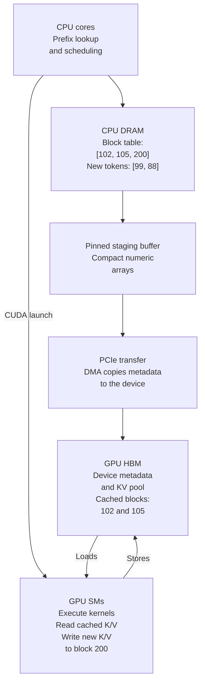
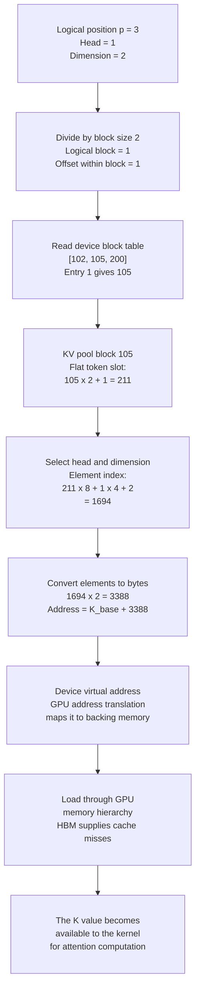
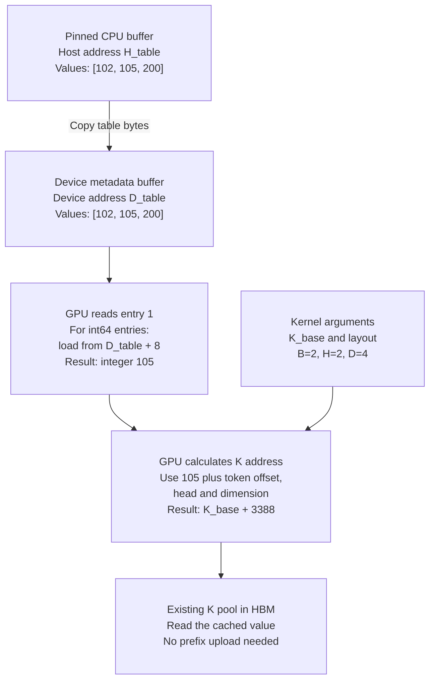
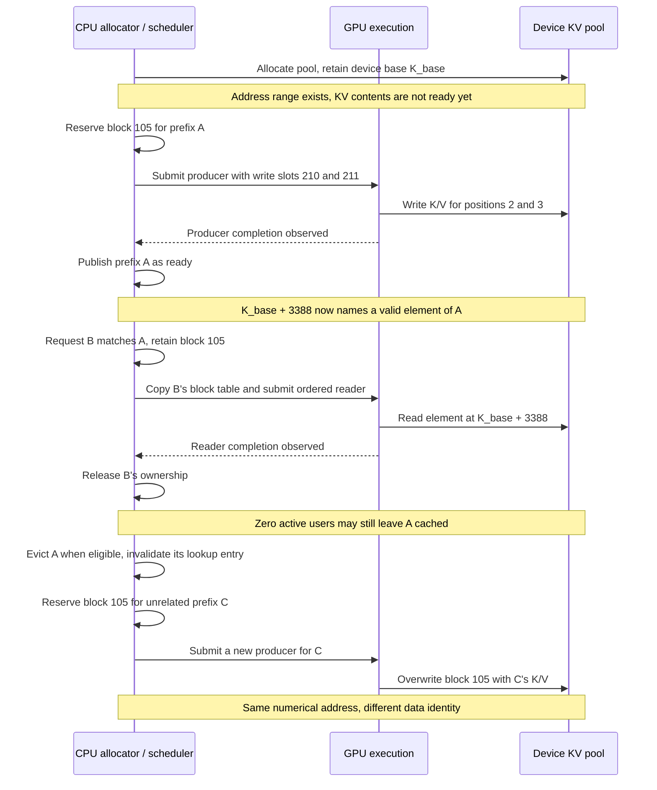

# From a CPU prefix match to bytes in GPU memory

The missing step in the trie explanation is an explicit contract: **the CPU chooses storage locations, transfers a compact description of those locations, and launches GPU code that interprets that description.** A GPU-resident cache hit does not require sending the cached K/V tensors from the CPU again.

Read the [prefix-trie walkthrough](./cs336-l18-kv-prefix-trie.notes.md) first. This deeper walkthrough follows the example with cached tokens `[10, 20, 30, 40]` and incoming request `[10, 20, 30, 40, 99, 88]`.

## 1. Assumptions: exactly which system are we describing?

The concrete example assumes:

| Property | Assumption |
| --- | --- |
| Hardware | One discrete NVIDIA GPU with HBM, connected to a CPU host over PCIe |
| Host memory | Ordinary CPU DRAM, with a small pinned staging area |
| Runtime | Linux, CUDA, and a Python/PyTorch serving worker |
| Model | A causal transformer with separate K and V tensors at each attention layer |
| Residency | Weights and reusable KV already reside on this GPU |
| Cache layout | A preallocated block pool; 2 tokens per block for the diagrams |
| Sharing | Reused blocks are complete, immutable, ready, and retained until readers finish |
| Compatibility | Same model weights, adapter, positions, token prefix, and other relevant model inputs |
| Scope | No offload, distributed workers, speculative execution, or sliding-window eviction in the main example |

These are teaching assumptions, not requirements for all serving engines. A Mac with unified memory does not have this same PCIe-to-discrete-HBM path. A GPU using GDDR has device memory but not HBM. NVLink between GPUs is not automatically the CPU-to-GPU connection.

The cache layout and code below are deliberately simplified. Production source links appear in section 8; they are not claims that every engine uses the same layout or backend.

## 2. CPU, GPU, and HBM: who computes and who stores?

**HBM is the GPU's attached high-bandwidth memory, not a third processor between the CPU and GPU.** GPU streaming multiprocessors (SMs) execute kernels. Their loads and stores access device memory through the GPU memory hierarchy.

| Component | What it does in this example |
| --- | --- |
| CPU cores | Tokenization, prefix lookup, scheduling, allocation bookkeeping, CUDA API calls |
| CPU DRAM | Python objects, trie/hash index, block ownership records, request metadata |
| Pinned CPU DRAM | Host buffers whose pages remain available for DMA transfers |
| PCIe | Carries host/device transfers and device communication |
| GPU copy engines | Carry out supported data transfers without CPU code copying each element |
| GPU HBM | Holds weights, KV pools, activations, and device copies of metadata |
| GPU SMs | Execute projection, attention, normalization, and other kernels |
| GPU caches, shared memory, registers | Supply temporary or cached working data close to computation |

Data stored in HBM can be read repeatedly during attention. The **KV cache** is a software-managed tensor store; it is distinct from hardware caches such as L2. For the host/device separation and memory hierarchy, see [NVIDIA's CUDA Best Practices Guide](https://docs.nvidia.com/cuda/cuda-c-best-practices-guide/index.html).



Loads and stores pass through the GPU memory hierarchy between the SMs and HBM.

The two paths into the GPU are related but different: a **data transfer** makes input bytes available; a **kernel launch** requests computation with particular arguments. Launching a kernel does not recursively copy Python objects or everything reachable from a pointer.

## 3. What exists before the new request arrives?

Imagine the worker allocated pools at startup:

```python
# Illustrative contiguous layout; each layer has its own K and V pool.
k_cache = torch.empty((num_blocks, block_size, num_kv_heads, head_dim),
                      dtype=torch.bfloat16, device="cuda")
v_cache = torch.empty_like(k_cache)
```

`torch.empty` reserves storage; it does not compute valid keys or values. An earlier request ran through the model and wrote:

```text
Physical block 102: K/V for token positions [10, 20]
Physical block 105: K/V for token positions [30, 40]
Physical block 200: available for the new request
```

Here, a physical block ID is an **allocator slot index** within a device pool. It is neither a token ID, a trie node ID, nor a raw DRAM address. The CUDA allocation exposes a device virtual base address; the kernel uses offsets from it.

For the tree from the original notes, the exact four-token match ends at node `4`. An extended cache manager could associate that prefix with blocks `[102, 105]`. Our original `TrieNode` has no such association; adding a GPU backend requires this new layer of metadata.

Request ownership and storage identity also differ. Two requests can reference the same immutable blocks without allocating a second copy of their contents.

## 4. The CPU builds a numeric execution description

For the new request, the scheduler finds a four-token hit and reserves block `200` for the two new tokens. The illustrative plan is:

| Field | Value | Consumer and meaning |
| --- | --- | --- |
| New token IDs | `[99, 88]` | Embedding/model input for suffix positions |
| Absolute positions | `[4, 5]` | Position handling and causal visibility |
| Block table | `[102, 105, 200]` | Attention reads: logical block → physical pool block |
| Write slots | `[400, 401]` | Cache writes: physical token slots for new K/V |
| Context length | `6` | Attention bounds; prevents reading unused space |
| Query length | `2` | Number of new positions to process |

Why `400`? With 2 tokens per block, `slot = physical_block * 2 + offset`. Block `200` therefore owns slots `400` and `401`.

A batch also needs request boundaries and per-request lengths. Some backends derive metadata on the GPU instead of transferring every field. The example shows what must be represented logically, not a universal wire format.

The CPU packs lists into fixed-dtype contiguous arrays. Through PyTorch or a C++ extension, it submits host-to-device copies and launches compiled kernels. The CUDA runtime/driver handles command submission and device execution. Exact hardware command packet formats are outside this application-level contract.

A pinned staging buffer allows the transfer engine to read stable host pages. Pinning does not move those bytes into HBM, and an asynchronous copy is not permission to overwrite its source early. See [NVIDIA's data-transfer explanation](https://developer.nvidia.com/blog/how-optimize-data-transfers-cuda-cc/).

## 5. Close the address-calculation gap

For logical position `p`, the attention kernel performs the equivalent of:

```text
logical_block  = p // block_size
within_block   = p % block_size
physical_block = block_table[logical_block]
```

With our plan:

| Logical position | Token | Logical block | Physical block | Within-block offset | Flat token slot |
| --- | --- | --- | --- | --- | --- |
| 0 | 10 | 0 | 102 | 0 | 204 |
| 1 | 20 | 0 | 102 | 1 | 205 |
| 2 | 30 | 1 | 105 | 0 | 210 |
| 3 | 40 | 1 | 105 | 1 | 211 |
| 4 | 99 | 2 | 200 | 0 | 400 |
| 5 | 88 | 2 | 200 | 1 | 401 |

For a contiguous `[blocks, B, H, D]` pool, element `(physical_block, offset, head, dimension)` has the following element index:

```text
element_index = (((physical_block * B + offset) * H + head) * D + dimension)
byte_address  = device_base_address + element_index * bytes_per_element
```

For example, use `B=2`, `H=2`, `D=4`, BF16 (2 bytes), position `3`, head `1`, dimension `2`:

```text
physical block = block_table[3 // 2] = 105
offset         = 3 % 2 = 1
element index  = (((105 * 2 + 1) * 2 + 1) * 4 + 2) = 1694
byte address   = K_base + 3388
```

Illustrative device code for that same layout:

```cpp
// Executed inside a CUDA kernel; all pointers below reference device memory.
// Simplified layout, not a drop-in vLLM kernel.
int pool_block = block_table[position / B];
int local_position = position % B;
int64_t element =
    (((int64_t(pool_block) * B + local_position) * H + head) * D + dim);
auto key_element = k_cache[element];
```

The physical layout may be reordered or packed for efficient GPU accesses. vLLM's documented paged-attention kernel uses block/head strides and a device block-table lookup to locate K/V. Read its [pointer-arithmetic walkthrough](https://docs.vllm.ai/en/stable/design/paged_attention/).

**The GPU never needs to understand the trie.** Its input is a pool pointer, an indexing scheme, a block table, lengths, and tensors. The CPU and kernel must agree on all their meanings.

### Diagram: follow one K element all the way to memory

Keep the layout assumptions above: one layer's contiguous K pool, `B=2`, `H=2`, `D=4`, and BF16. We want **position 3, head 1, dimension 2**. Position 3 contains token `40`; the token ID itself is not an address.



There are **two different mappings** here:

| Mapping | Owner | Input → output |
| --- | --- | --- |
| KV block-table lookup | Serving software and attention kernel | Logical block `1` → allocator slot `105` |
| Device virtual-memory translation | CUDA-managed mappings and GPU hardware | Device virtual address → physical backing memory |

“Physical block 105” is the serving allocator's terminology. It is not hardware page number 105. A KV block and a hardware memory page need not have the same size or boundaries. The diagram is a conceptual dependency chain, not an assertion about the exact ordering of a particular GPU's translation and cache pipelines. CUDA distinguishes virtual address ranges from physical backing allocations; see [NVIDIA's virtual-memory guide](https://docs.nvidia.com/cuda/cuda-programming-guide/04-special-topics/virtual-memory-management.html).

For a made-up `K_base = 0x10000000`, the computed address is `0x10000D3C`, because `3388 = 0xD3C`. That is still a **device virtual address**, not an HBM chip/bank/row coordinate. The driver and hardware handle the latter mapping; our kernel does not calculate it.

The V value uses its own pool base, `V_base`. Each layer also has its own cache storage in this assumed layout. The same token slot alone does not identify which layer or whether we want K or V.

### Diagram: which address crosses the CPU/GPU boundary?

A block-table entry is a small integer. The table itself occupies memory and has an address too. Do not confuse the **address of the table entry** with the **KV address derived from its value**.



`H_table` and `D_table` are symbolic pointers to different buffers. The copy transfers their **contents**, not the CPU pointer as a substitute for a device pointer. The CPU passes the valid device pointer `D_table` to the kernel through its launch arguments; `K_base` similarly names an existing device allocation. A host-side Python tensor object can hold device-pointer metadata without its numerical tensor storage residing on the CPU.

This diagram assumes int64 metadata, so entry 1 is 8 bytes from the table base. A backend using int32 entries would use 4 bytes. This metadata dtype is independent of the BF16 dtype of the K/V values.

The table-entry read is itself a device-memory load. Only after obtaining its value can the kernel derive the K address. Neither load requires a round trip to the CPU under our GPU-resident assumptions.

## 6. How new K/V actually get into HBM

For each transformer layer, the suffix hidden states pass through the relevant projections. This produces Q/K/V for new positions on the GPU. Position transformations are applied as required by the model. Cache-writing code stores new K/V at the assigned slots, and attention reads the cached prefix plus the causally visible new positions.

```text
Suffix hidden states on GPU
    → layer projections and position handling
    → new K and V on GPU
    → cache write using slots [400, 401]
    → attention reads through [102, 105, 200]
    → output hidden states for the next layer
```

At suffix position `4`, attention can see positions `0..4`. At position `5`, it can see `0..5`. Having allocated block `200` does not make all its entries valid or visible to every query.

The new K/V values normally originate from GPU computation, not CPU calculations followed by an upload. Separate kernels can write intermediate tensors; fused implementations can combine operations. vLLM's [cache kernels](https://github.com/vllm-project/vllm/blob/main/csrc/cache_kernels.cu) explicitly use `slot_mapping` to determine the destination block and offset.

## 7. Readiness and ownership replace the “leap of faith”

Address arithmetic is only half the contract. My design review would require these invariants:

| Invariant | Failure if violated |
| --- | --- |
| Matching cache identity | Valid tensor bytes belong to a different model/context |
| Agreed dtype, shape, strides, and device | The kernel interprets the wrong bytes or addresses |
| Metadata copied before consumption | The kernel reads stale block IDs |
| KV writes ordered before KV reads | Attention reads unfinished values |
| Retained storage until all readers finish | A block is recycled while a kernel still uses it |
| Shared prefix remains immutable | One request corrupts another request's context |
| Lengths and causal masks agree | Uninitialized or future positions enter attention |

CUDA streams express execution order. Operations in one stream are ordered; different streams require dependencies when one consumes another's results. An event recorded after a copy can gate computation on another stream. Submission returning to Python does not imply GPU completion. See [CUDA asynchronous execution](https://docs.nvidia.com/cuda/cuda-programming-guide/02-basics/asynchronous-execution.html).

```text
Host:          fill buffer → enqueue copy → enqueue work → do other CPU work
Copy stream:                 H2D metadata → record ready
Compute stream:                             wait ready → kernels → record done
Host storage:  keep buffers valid and unchanged until their use finishes
KV blocks:     keep ownership until all GPU readers finish
```

Waiting for `done` before returning simplifies buffer lifetimes. A server can poll completion events and recycle buffers later. Reusable staging buffers need completion tracking too; otherwise the next batch can overwrite bytes still being transferred.

A cache manager can expose entries early if every consumer inherits the correct dependency; alternatively it can publish only completed entries. The invariant is that no consumer reads before the producer finishes. A plain `is_cached = True` flag does not enforce that ordering.

Reference counts protect ownership; completion tracking protects in-flight use. Eviction must respect both. If an implementation shares partially filled blocks and later appends divergently, it needs private storage or copy-on-write. Our example avoids that by sharing only complete blocks. For real allocator bookkeeping, see [vLLM's block pool](https://github.com/vllm-project/vllm/blob/main/vllm/v1/core/block_pool.py).

### Diagram: the lifetime of an address and the data it names

Follow block `105` from its first producer through a later cache hit. This diagram assumes the worker retains the same pool allocation and does not remap it during these requests. Completion means GPU work has finished, not merely that Python submitted it.



There are three lifetimes to keep separate:

- **Allocation lifetime:** the pool's device address range remains usable while the allocation is owned and valid. Returning a KV block to a software free list does not necessarily free or unmap the underlying CUDA allocation.
- **Content lifetime:** a particular prefix owns the meaning of those bytes until eviction and reuse. The address can stay numerically unchanged while its contents become a different prefix's K/V.
- **In-flight access lifetime:** queued kernels may still read the block after the CPU has moved on. Storage cannot be overwritten until those readers finish, even if the request has been cancelled on the host.

After reuse for C, an old table containing `105` may still produce an in-bounds address, but the result is semantically wrong. This can silently corrupt attention rather than crash. Correct invalidation, ownership, and completion tracking prevent that stale-table use.

The sequence illustrates a conservative publish-after-completion policy. An engine may instead publish a pending entry with an explicit dependency, as discussed above. Either way, an address being allocated is not proof that the correct prefix's data is ready.

## 8. Where this appears in production code

These are real vLLM source entry points inspected for this explanation. The links track `main`, so symbol organization can change; pin your deployed revision when investigating an incident.

| Responsibility | Production source to inspect |
| --- | --- |
| Find reusable blocks and maintain ownership/free lists | [block_pool.py](https://github.com/vllm-project/vllm/blob/main/vllm/v1/core/block_pool.py) |
| Maintain block-table metadata for execution | [block_table.py](https://github.com/vllm-project/vllm/blob/main/vllm/v1/worker/block_table.py) |
| Prepare worker inputs and execute the model | [gpu_model_runner.py](https://github.com/vllm-project/vllm/blob/main/vllm/v1/worker/gpu_model_runner.py) |
| Write computed K/V into physical slots | [cache_kernels.cu](https://github.com/vllm-project/vllm/blob/main/csrc/cache_kernels.cu); search for `slot_mapping` |
| Understand device reads through physical block indices | [Paged-attention kernel explanation](https://docs.vllm.ai/en/stable/design/paged_attention/) |

Follow the data in that order. The source-level bridge is the metadata tensor plus the kernel arguments. It is not a CPU `TrieNode` object being sent to CUDA. Specific attention backends can use different kernels from the documented paged-attention example.

## 9. How much data moves?

Separate **host/device traffic** from **GPU memory traffic**. A local cache hit can avoid transferring the prefix across PCIe while still reading its K/V through the GPU memory hierarchy during attention.

Here is an independent size calculation for an assumed model with 32 layers, 8 KV heads, head dimension 128, and BF16 K/V:

```text
KV bytes per token = 2 (K and V) × 32 layers × 8 KV heads × 128 × 2 bytes
                   = 131,072 bytes = 128 KiB

KV for a 4,096-token prefix = 4,096 × 128 KiB = 512 MiB
```

With an assumed production block size of 16, that prefix has 256 blocks. A single 32-bit block-table row would occupy `256 × 4 = 1,024 bytes`, excluding other metadata. Reusing 512 MiB of resident KV can therefore involve a roughly 1 KiB block-table description instead of uploading those 512 MiB. This is a size comparison, not a latency benchmark or total traffic estimate.

Using int64 for the new token IDs, positions, block table, and write slots in our example gives `(2 + 2 + 3 + 2) × 8 = 72 bytes`. This excludes lengths, other metadata, launch overhead, and startup initialization.

For intuition only, assume an effective transfer rate of 25 GB/s. Moving 512 MiB then takes at least `536,870,912 / 25,000,000,000 ≈ 21.5 ms`, before other overheads. That is hypothetical arithmetic, not a claim about a particular GPU. Tiny transfers are often dominated by submission and synchronization costs rather than payload bandwidth.

## 10. What changes when the KV is elsewhere?

The original residency assumption matters:

| Location of reusable KV | Additional work before local attention can read it |
| --- | --- |
| Same GPU HBM | Retain blocks, supply metadata, enforce readiness |
| CPU DRAM after offload | Allocate destination slots and transfer tensor bytes back to the GPU |
| Another GPU | Transfer or otherwise access remote data using a supported topology and execution design |
| Another machine | Coordinate a network transfer and destination placement before use |
| Evicted with no retained copy | Recompute the missing state |

These architectural cases require additional data-placement mechanisms. A remote block ID `102` has no useful local meaning unless a protocol maps it to the destination worker's storage. Distributed cache reuse needs both an identity match and a data-placement protocol.

Likewise, a process boundary between scheduler and worker adds an IPC/RPC step before the worker's CUDA submission. The prefix tree can live in a different process from the GPU owner, but Python object references and raw pointers are not automatically portable across that boundary.

## 11. What I would verify as the platform owner

I would first validate numerical correctness: compare cached and uncached execution with tolerances appropriate to the dtype/backend, including partial hits and divergent suffixes. Then exercise concurrent reuse and eviction to expose ownership errors.

For performance, I would measure these separately:

- CPU lookup, batching, and input-preparation time.
- H2D payload size and transfer duration.
- Gaps between metadata readiness and GPU execution.
- Prefill GPU time saved by hits of different lengths.
- Cache occupancy, eviction rate, and repeated recomputation.
- End-to-end time to first token and output-token latency under realistic load.

A CUDA timeline should show the dependency chain we drew. Overlap requires suitable hardware and independent work; two streams do not make dependent copy and compute simultaneous. See [NVIDIA's explanation of overlapping transfers and computation](https://developer.nvidia.com/blog/how-overlap-data-transfers-cuda-cc).

The engineering question at every boundary is concrete: **which bytes exist, which address names them, which operation produces them, and what prevents the consumer from reading too early or after reuse?**
