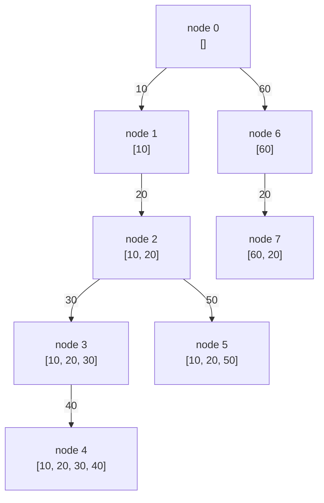
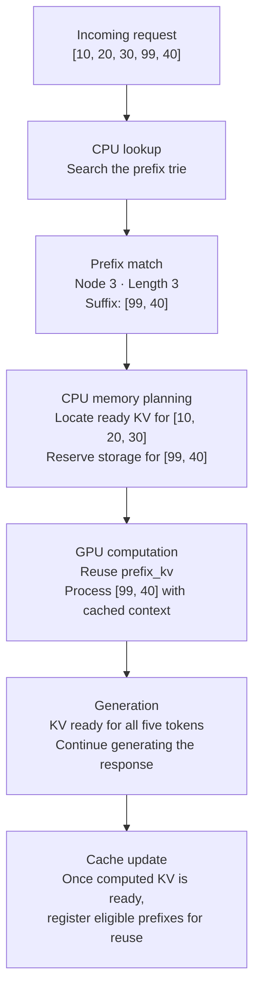
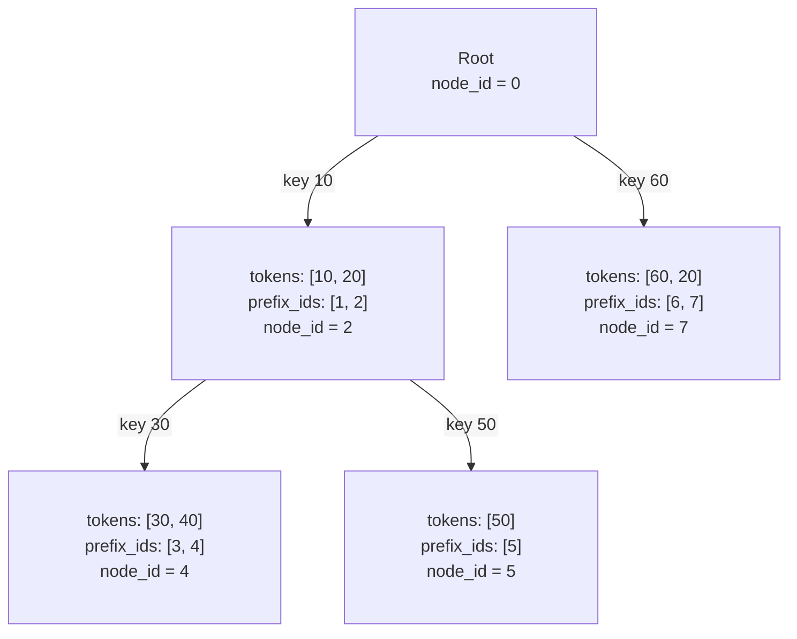

# KV-cache prefix caching: from tokens to a trie

These notes explain the [Python implementation](./cs336-l18-kv-prefix-trie.py). Start with the reason for caching, follow one example through insertion and lookup, then connect the result to GPU execution.

The walkthrough below first explains the original `KVCacheTrie`. The wrapper now uses `KVCacheRadixTree`, which compresses nonbranching paths into token-sequence edges while preserving the same results. Each edge stores the original prefix IDs so a match ending inside an edge still returns the correct `cache_node`. Leaf extensions are merged into the same edge; insertions that diverge split an edge. These are logical prefix IDs, not necessarily separate radix-node objects.

## 1. What work are we trying to avoid?

A language model receives text as a sequence of **tokens**. Each token has an integer ID; a token might represent a word, part of a word, or punctuation.

An autoregressive model generates its response one token at a time. There are two useful phases to distinguish:

- **Prefill:** process the input prompt to build the model's state for that prompt.
- **Decode:** generate successive output tokens using the preceding context.

In a causal transformer, attention at a token can use that token and earlier tokens, but cannot see future tokens. At each attention layer, the model computes queries (**Q**), keys (**K**), and values (**V**). A query is compared with keys to determine how to combine the values.

The **KV cache** stores earlier tokens' keys and values so later tokens can attend to them without recomputing them. It contains numerical tensors, not just token IDs or previously generated text.

Now suppose two requests begin with the same long system prompt:

```text
Request A: [ shared system instructions ][ Explain gravity ]
Request B: [ shared system instructions ][ Explain rain    ]
            └──── identical prefix ────┘
```

**Prefix caching** extends KV reuse across requests: keep the computed KV state for that shared beginning and reuse it when processing another request.

This mainly saves prefill work. It does not eliminate the computation needed to generate new output tokens. The benefit depends on how much of the prompt matches and whether its cache is still available; there is no fixed percentage speedup. See the [vLLM prefix-caching overview](https://github.com/vllm-project/vllm/blob/main/docs/features/automatic_prefix_caching.md).

## 2. Why must the match start at the beginning?

A **prefix** is a sequence starting at position zero. For `[10, 20, 30]`, the prefixes are `[]`, `[10]`, `[10, 20]`, and `[10, 20, 30]`.

Consider:

```text
Cached:   [10, 20, 30, 40]
Request:  [10, 20, 99, 40]
           ✓   ✓   ✗
Reusable: [10, 20]
Remaining:        [99, 40]
```

We stop at `99`. We cannot resume matching at `40`: its preceding context has changed. In a multilayer causal transformer, a token's cached state generally depends on the tokens before it, not just its own ID.

For this exercise, assume all sequences use the same model and tokenization, matching positions and other model inputs, and that every inserted prefix has valid cached state. Production systems must account for those conditions when deciding whether reuse is valid.

## 3. A trie stores shared beginnings once

A **trie**, or prefix tree, stores sequences as paths from a root:

- The **root** represents `[]` and has node ID `0`.
- Each **edge** is labeled with one token ID.
- Each **node** identifies the entire prefix along the path from the root to that node.
- A node's `children` dictionary maps the next token ID to its child node.

Two IDs appear here, with different jobs:

| Name | Meaning | Example |
| --- | --- | --- |
| Token ID | A value in the input sequence | `20` |
| Node ID | A unique identifier assigned to a trie node | `2`, representing prefix `[10, 20]` |

**A node ID is not a GPU memory address.** The exercise stores only the tree and its node IDs; it does not compute or store actual K/V tensors.

## 4. Build the trie with sample data

Insert these cached sequences **in this order**:

```python
cached_sequences = [
    [10, 20, 30, 40],
    [10, 20, 50],
    [60, 20],
]
```

Node IDs increase only when a new node is created:

| Insertion | Existing path reused | New nodes created |
| --- | --- | --- |
| `[10, 20, 30, 40]` | Root only | `1`, `2`, `3`, `4` |
| `[10, 20, 50]` | Root → `1` → `2` | `5` |
| `[60, 20]` | Root only | `6`, `7` |

In this diagram, edge labels are **token IDs** and boxes show **node IDs and their prefixes**:



The same tree as plain text:

```text
node 0 (root)
├── token 10 → node 1
│   └── token 20 → node 2
│       ├── token 30 → node 3
│       │   └── token 40 → node 4
│       └── token 50 → node 5
└── token 60 → node 6
    └── token 20 → node 7
```

Notice that token `20` appears at two different nodes. Node `2` represents `[10, 20]`; node `7` represents `[60, 20]`. Different prefixes need different nodes even if their last token is identical.

### How `insert()` builds this structure

The implementation starts at the root and repeats this step for each token:

```python
if token not in current.children:
    new_node = TrieNode()
    new_node.node_id = self.next_node_id
    self.next_node_id += 1
    current.children[token] = new_node
current = current.children[token]
```

If the edge exists, follow it. Otherwise, create a child, assign the next unused ID, and follow it. For example, inserting `[10, 20, 50]` follows existing edges `10` and `20`, then creates only the edge for `50` and node `5`.

There is no end-of-sequence flag because we need reusable prefixes, not a test of whether an entire sequence was explicitly inserted. Inserting `[10, 20, 30, 40]` makes `[10, 20]` a valid match too.

## 5. Trace a lookup one token at a time

Search for this request in the tree above:

```python
request = [10, 20, 30, 99, 40]
```

`search_prefix()` begins with `current = root`, `matched_length = 0`, and `cache_node = 0`.

| Next token | Current node | Does the child exist? | Action | Matched length |
| --- | --- | --- | --- | --- |
| `10` | `0` | Yes | Move to node `1` | `1` |
| `20` | `1` | Yes | Move to node `2` | `2` |
| `30` | `2` | Yes | Move to node `3` | `3` |
| `99` | `3` | No; its only child is `40` | Stop at node `3` | `3` |
| `40` | — | Not checked | Already stopped | `3` |

The final slice is:

```python
uncached_suffix = request[matched_length:]
# request[3:] == [99, 40]
```

The returned record is:

```python
{
    "matched_length": 3,
    "cache_node": 3,
    "uncached_suffix": [99, 40],
}
```

- `matched_length` counts reusable tokens from the start of the request.
- `cache_node` identifies the deepest matched node, representing `[10, 20, 30]`.
- `uncached_suffix` contains everything after that prefix, including the first mismatching token.

The two `3`s are coincidental. Searching for `[10, 20, 50]` returns `matched_length = 3` but `cache_node = 5`.

## 6. Run the complete example

Run this after the definitions in the companion Python file:

```python
cached_sequences = [[10, 20, 30, 40], [10, 20, 50], [60, 20]]
requests = [
    [10, 20, 30, 99, 40],  # Partial match; stop at the first mismatch.
    [10, 20, 50],          # Full match on a different branch.
    [10, 20],              # A shorter prefix is also reusable.
    [60, 20, 70],          # Match two tokens, then extend.
    [20, 30],              # 20 exists in the tree, but not at the root.
    [],                    # An empty request.
]

print(kv_prefix_trie(cached_sequences, requests))
```

Expected result:

```python
{
    "matches": [
        {"matched_length": 3, "cache_node": 3, "uncached_suffix": [99, 40]},
        {"matched_length": 3, "cache_node": 5, "uncached_suffix": []},
        {"matched_length": 2, "cache_node": 2, "uncached_suffix": []},
        {"matched_length": 2, "cache_node": 7, "uncached_suffix": [70]},
        {"matched_length": 0, "cache_node": 0, "uncached_suffix": [20, 30]},
        {"matched_length": 0, "cache_node": 0, "uncached_suffix": []},
    ]
}
```

### What each part of the file does

| Component | Responsibility |
| --- | --- |
| `TrieNode` | Store a node's ID and its children |
| `KVCacheTrie.__init__()` | Create root `0`; initialize the next ID to `1` |
| `insert(sequence)` | Add missing edges and nodes |
| `search_prefix(request)` | Follow matching edges; return the match and remaining tokens |
| `kv_prefix_trie(cached_sequences, requests)` | Build one trie, search every request, and wrap results in `{"matches": ...}` |

**Searching does not insert anything.** Later requests in the same call cannot reuse a suffix discovered in an earlier request. Only `cached_sequences` populate the tree, and each call to `kv_prefix_trie()` builds a fresh tree.

## 7. How does a lookup help the GPU?

The exercise answers: **“Which prefix can be reused?”** An inference engine must also answer: **“Where are its K/V tensors, and are they ready to use?”**

A useful architecture separates a CPU metadata index from GPU tensor storage. SGLang's original RadixAttention design describes this split: the CPU maintains the tree, while KV tensors reside on the GPU. See the [RadixAttention explanation](https://www.lmsys.org/blog/2024-01-17-sglang/).

The following is an illustrative execution flow. `prefix_kv` and `suffix_kv` are symbolic tensor references, not values returned by our Python code.



The key distinction is between **recomputing prefix K/V** and **reading prefix K/V**:

```text
Position:       0       1       2       3       4
Token:         10      20      30      99      40
KV work:      reuse   reuse   reuse   compute compute

Attention for 99 reads K/V for: 10, 20, 30, 99
Attention for 40 reads K/V for: 10, 20, 30, 99, 40
```

The suffix is processed with the cached context. It is not an independent prompt. The GPU still reads the cached prefix during attention for new positions.

A production metadata record needs references to tensor storage, readiness information, and ownership tracking. Reference counts help prevent eviction while requests use a cache entry; an eviction policy also needs information about which unused entries to remove. The two-field `TrieNode` in this exercise omits all of this.

A full trie match returns an empty suffix, but this alone is not a complete generation plan: the exercise does not handle logits, token sampling, or any final-position work an engine might need to produce the next token.

## 8. Trie, radix tree, and GPU blocks are different concepts

### A radix tree compresses paths

The original `KVCacheTrie` uses **one token per edge**. A radix tree can combine a chain of edges with no branching into one edge labeled by a token sequence:

```text
Token trie:                       Compressed radix tree:

root                              root
└── 10                            └── [10, 20]
    └── 20                            ├── [30, 40]
        ├── 30                        └── [50]
        │   └── 40
        └── 50
```

Both organize shared prefixes. The compressed version also needs logic to split edges when a new sequence branches partway through an edge. The new `KVCacheRadixTree` implements that split logic and is selected by `kv_prefix_trie()`. The [original SGLang design](https://www.lmsys.org/blog/2024-01-17-sglang/) explains its use of a radix tree.

### Follow the actual radix implementation

The diagrams in sections 4–5 show the original token trie so that every prefix is visible. The active implementation compresses those paths. **One box below is one `RadixNode` object; its `tokens` list describes the incoming edge.** The dictionary key on an arrow is only the first token of that edge.

Insert the same three sequences in order:

```python
[10, 20, 30, 40]
[10, 20, 50]
[60, 20]
```

After the first insertion, the entire path is one object:

```text
root
└── key 10 → tokens=[10, 20, 30, 40], prefix_ids=[1, 2, 3, 4]
```

`tokens[i]` and `prefix_ids[i]` are aligned: consuming token `30` at edge offset `2` reaches logical prefix ID `3`. The IDs describe prefixes from the root, not isolated tokens. The object's `node_id` is the final ID in its list, here `4`.

On the second insertion, `insert()` looks up key `10` and compares the incoming sequence with the edge:

```text
Existing edge: [10, 20, 30, 40]
New sequence:  [10, 20, 50]
                ✓   ✓   ✗
common = 2
position = 2
```

The implementation splits the existing edge into a shared beginning and its old remainder, then adds the new branch:

| Code operation | Result |
| --- | --- |
| `branch = RadixNode(child.tokens[:common], child.prefix_ids[:common])` | Shared edge `[10, 20]` retains IDs `[1, 2]` |
| Slice the old child's two lists after `common` | Old edge becomes `[30, 40]`, with IDs `[3, 4]`; its descendants remain attached |
| `branch.children[child.tokens[0]] = child` | Key `30` points to that old remainder |
| `current.children[token] = branch` | Root key `10` now points to the shared edge |
| Create the new suffix edge | Key `50` points to `[50]`, with newly allocated ID `[5]` |

The third insertion creates a separate root edge `[60, 20]`, with IDs `[6, 7]`. The final structure is:



This uses **5 objects including the root**, compared with **8 objects** in the original trie. All seven logical prefix IDs still exist as integers in edge lists. Compression reduces node objects and child dictionaries; it does not remove the token labels or compatibility IDs.

### Lookup can stop inside a box

For request `[10, 20, 30, 99, 40]`, follow this trace through the diagram:

| Edge and action | `matched_length` | `cache_node` |
| --- | --- | --- |
| Root key `10` selects `[10, 20]`; consume `10` | 1 | 1 |
| Consume `20` in the same edge | 2 | 2 |
| Key `30` selects `[30, 40]`; consume `30` | 3 | 3 |
| Compare request token `99` with edge token `40`; stop | 3 | 3 |

The result is `{"matched_length": 3, "cache_node": 3, "uncached_suffix": [99, 40]}`. **There is no separate radix object for ID `3`.** It is stored at `prefix_ids[0]` inside the `[30, 40]` edge. Returning that object's endpoint ID `4` would be incorrect; the code uses `child.prefix_ids[common]` for each matched token.

A request ending at `[10]` also stops inside an edge and returns a full one-token match. Inserting `[10]` later does not split the edge: this cache treats all prefixes as valid and has no terminal markers.

### Extending a leaf keeps the path compressed

Now insert `[10, 20, 30, 40, 80]` after all three sequences above. The old leaf has no children, so `insert()` extends its lists rather than adding a one-child chain:

```text
Before: tokens=[30, 40]      prefix_ids=[3, 4]
After:  tokens=[30, 40, 80]  prefix_ids=[3, 4, 8]
```

IDs `5`, `6`, and `7` already belong to other prefixes. This explains why the implementation stores an explicit ID list rather than assuming IDs along an edge are consecutive. The number of radix objects stays at five; the extended leaf's `node_id` becomes `8`.

### Live code: build, print, and query the diagram

Paste the following implementation into a Python notebook cell. It is the radix implementation from the companion source, with the same wrapper signature; it needs no third-party libraries. Then run the demonstration cell immediately below it.

```python
class RadixNode:
    """A compressed incoming edge and branches keyed by their first token.

    Each token retains its original prefix ID so partial-edge matches return
    the same cache_node as the token trie. IDs need not be consecutive when
    an existing leaf is extended after other branches have been inserted.
    """

    def __init__(self, tokens: list[int], prefix_ids: list[int]):
        self.tokens = tokens
        self.prefix_ids = prefix_ids
        self.children = {}

    @property
    def node_id(self) -> int:
        """ID of the prefix at the end of this edge; the root is zero."""
        return self.prefix_ids[-1] if self.prefix_ids else 0


class KVCacheRadixTree:
    """Path-compressed trie with the same results and prefix IDs as KVCacheTrie."""

    def __init__(self):
        self.root = RadixNode([], [])
        self.next_node_id = 1

    def insert(self, sequence: list[int]):
        """Insert a cached sequence, splitting an edge only when paths diverge."""
        current = self.root
        position = 0
        while position < len(sequence):
            token = sequence[position]
            child = current.children.get(token)
            if child is None:
                # Copy the suffix so caller mutations cannot change the tree.
                suffix = sequence[position:]
                prefix_ids = list(range(self.next_node_id, self.next_node_id + len(suffix)))
                if current is not self.root and not current.children:
                    # Extend a leaf instead of introducing a unary branch.
                    current.tokens.extend(suffix)
                    current.prefix_ids.extend(prefix_ids)
                else:
                    current.children[token] = RadixNode(suffix, prefix_ids)
                self.next_node_id += len(suffix)
                return

            common = 0
            while (common < len(child.tokens)
                   and position + common < len(sequence)
                   and child.tokens[common] == sequence[position + common]):
                common += 1

            position += common
            if position == len(sequence):
                # All prefixes are cached; no terminal marker or split is needed.
                return
            if common == len(child.tokens):
                current = child
                continue

            # First-token lookup guarantees common >= 1. Preserve old prefix
            # IDs and descendants while turning the common path into a branch.
            branch = RadixNode(child.tokens[:common], child.prefix_ids[:common])
            child.tokens = child.tokens[common:]
            child.prefix_ids = child.prefix_ids[common:]
            branch.children[child.tokens[0]] = child
            current.children[token] = branch

            suffix = sequence[position:]
            prefix_ids = list(range(self.next_node_id, self.next_node_id + len(suffix)))
            branch.children[suffix[0]] = RadixNode(suffix, prefix_ids)
            self.next_node_id += len(suffix)
            return

    def search_prefix(self, request: list[int]) -> dict:
        """Match tokens along compressed edges, including partial-edge matches."""
        current = self.root
        matched_length = 0
        cache_node = 0
        while matched_length < len(request):
            child = current.children.get(request[matched_length])
            if child is None:
                break
            common = 0
            while (common < len(child.tokens)
                   and matched_length < len(request)
                   and child.tokens[common] == request[matched_length]):
                cache_node = child.prefix_ids[common]
                matched_length += 1
                common += 1
            if common < len(child.tokens):
                break
            current = child

        return {
            "matched_length": matched_length,
            "cache_node": cache_node,
            "uncached_suffix": request[matched_length:],
        }


def kv_prefix_trie(cached_sequences: list, requests: list) -> dict:
    """
    Returns a dict with matches: records of matched_length, cache_node, and uncached_suffix.
    """
    # trie = KVCacheTrie()
    trie = KVCacheRadixTree()

    # Step 1 : Build the Trie by inserting cached sequences in input order
    for seq in cached_sequences:
        trie.insert(seq)

    # Step 2 : Evaluate each request against the constructed KV-cache Trie
    matches = [trie.search_prefix(req) for req in requests]

    return {"matches": matches}
```

The printer exposes exactly the fields shown in the boxes. This demonstration first builds the diagram, then checks a partial-edge lookup and the leaf extension:

```python
def show_radix(node, indent=""):
    if not node.tokens:
        print("root (node_id=0)")
    for key, child in sorted(node.children.items()):
        print(f"{indent}key={key}: tokens={child.tokens}, "
              f"prefix_ids={child.prefix_ids}, node_id={child.node_id}")
        show_radix(child, indent + "    ")


tree = KVCacheRadixTree()
cached_sequences = [[10, 20, 30, 40], [10, 20, 50], [60, 20]]
for sequence in cached_sequences:
    tree.insert(sequence)
show_radix(tree.root)

request = [10, 20, 30, 99, 40]
result = tree.search_prefix(request)
print("Lookup:", result)
assert result == {
    "matched_length": 3, "cache_node": 3, "uncached_suffix": [99, 40]
}
assert kv_prefix_trie(cached_sequences, [request]) == {"matches": [result]}
assert tree.search_prefix([10]) == {
    "matched_length": 1, "cache_node": 1, "uncached_suffix": []
}

tree.insert([10, 20, 30, 40, 80])
leaf = tree.root.children[10].children[30]
assert leaf.tokens == [30, 40, 80]
assert leaf.prefix_ids == [3, 4, 8]
print("Extended leaf:", leaf.tokens, leaf.prefix_ids)
```

Expected output:

```text
root (node_id=0)
key=10: tokens=[10, 20], prefix_ids=[1, 2], node_id=2
    key=30: tokens=[30, 40], prefix_ids=[3, 4], node_id=4
    key=50: tokens=[50], prefix_ids=[5], node_id=5
key=60: tokens=[60, 20], prefix_ids=[6, 7], node_id=7
Lookup: {'matched_length': 3, 'cache_node': 3, 'uncached_suffix': [99, 40]}
Extended leaf: [30, 40, 80] [3, 4, 8]
```

### Blocks organize physical KV storage

A GPU block holds KV data for a group of token positions. A block table maps a request's logical positions to physical storage. A trie node and a GPU block do not necessarily have a one-to-one relationship.

For an illustrative block size of **2 tokens**, a request might use this mapping:

```text
Previously cached prompt: [10, 20, 30, 40]
New request:              [10, 20, 30, 40, 99, 88]

Logical block:       0          1          2
Tokens:           [10, 20]   [30, 40]   [99, 88]
Physical block:      102        105        200
Action:             reuse      reuse      allocate + compute

New request's block table: [102, 105, 200]
```

These physical block IDs are made-up examples, independent of our trie node IDs.

Engines can use different indexes. vLLM documents a block-hash approach that incorporates preceding context rather than using this token-by-token trie. It also documents caching full blocks, so a token-level match can exceed the reusable block-aligned length. For example, with blocks of 2, a three-token match may permit reuse of only the first two tokens. See the [vLLM design documentation](https://docs.vllm.ai/en/latest/design/prefix_caching/).

## 9. Edge cases and cost

| Situation | Behavior of this implementation |
| --- | --- |
| No cached sequences | Every request has match length `0` and its entire input as the suffix |
| Empty cached sequence | Creates no nodes |
| Empty request | Returns length `0`, root ID `0`, and suffix `[]` |
| Same sequence inserted twice | Reuses existing nodes; creates no new IDs |
| First token missing | Stops at the root |
| Request ends at an internal node | Returns a full match; no leaf or terminal marker is required |
| Cached sequences inserted in a different order | Matching lengths stay the same, but assigned node IDs can change |

For the original token trie, assuming average constant-time dictionary operations:

- Inserting a sequence of length `L` takes **O(L)** time.
- Searching a request of length `R` takes **O(R)** time overall. Traversal stops at the first mismatch, but creating the suffix list also copies its elements.
- The trie needs **O(U)** space, where `U` is the number of distinct nonempty prefixes, plus the root. Shared paths save nodes.
- Each returned suffix needs space proportional to its length. Building the trie takes time proportional to the total number of tokens in the cached input sequences, including repeated tokens.

For the radix version, lookup still compares tokens individually and takes **O(R)** overall, including the returned suffix. Compression saves objects and dictionary traversals, not the need to check each token. Its token and prefix-ID lists still use **O(U)** storage in total.

This Python implementation copies lists when it splits an edge. Splitting an existing edge of length `E` can therefore make an insertion cost **O(L + E)**, even for a short new sequence. Extending a leaf can also trigger list reallocation; appends are amortized, not guaranteed constant time per operation. Do not assume compression automatically makes every insertion faster.

## 10. Where would this be useful?

| Workload | Potential shared prefix |
| --- | --- |
| Chatbots | System instructions and fixed examples |
| Multi-turn conversations | Earlier messages, if the serialized token prefix stays unchanged |
| Retrieval-augmented generation (RAG) | The same retrieved document placed after the same preceding instructions |
| Coding assistants | A shared repository context at the beginning of requests |
| Tool-using agents | Fixed tool definitions and instructions |

In each case, reuse requires an exact compatible prefix. Similar meaning, the same document later in a different context, or the same final token is insufficient.

## 11. Check your understanding

Using the sample trie above:

1. What does `[10, 20, 50, 70]` return?
2. Why does `[20]` fail even though two edges are labeled `20`?
3. Does inserting `[10, 20]` after the existing sequences create new nodes?
4. Does searching for `[10, 20, 99]` make `99` available to the next request?

<details>
<summary>Answers</summary>

1. `{"matched_length": 3, "cache_node": 5, "uncached_suffix": [70]}`.
2. Lookup must start at the root, which has children `10` and `60`, not `20`.
3. No. The entire path already exists.
4. No. Search only reads the trie. In a serving engine, new KV must be computed and registered before it can be reused.

</details>

## 12. Go deeper: how does the CPU communicate with the GPU?

A prefix match becomes numeric metadata: block IDs, token positions, sequence lengths, and write locations. The CPU transfers this metadata and submits GPU work; cached K/V already in HBM stays there. GPU kernels turn block IDs into addresses and read those tensors directly.

The [CPU-to-GPU data-movement walkthrough](./cpu-gpu-kv-data-movement.md) explains the hardware assumptions, PCIe transfers, HBM, address arithmetic, CUDA streams/events, ownership, and the corresponding production source files. It includes a [runnable PyTorch demonstration](./cpu-gpu-kv-data-movement.md#8-run-a-small-data-movement-demonstration) with a CPU mode for checking the indexing without CUDA hardware.
